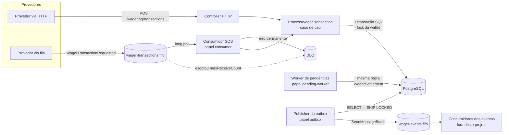
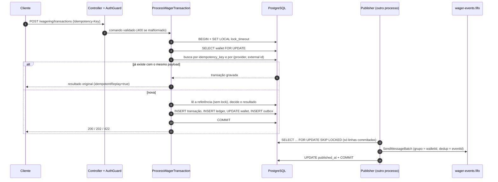
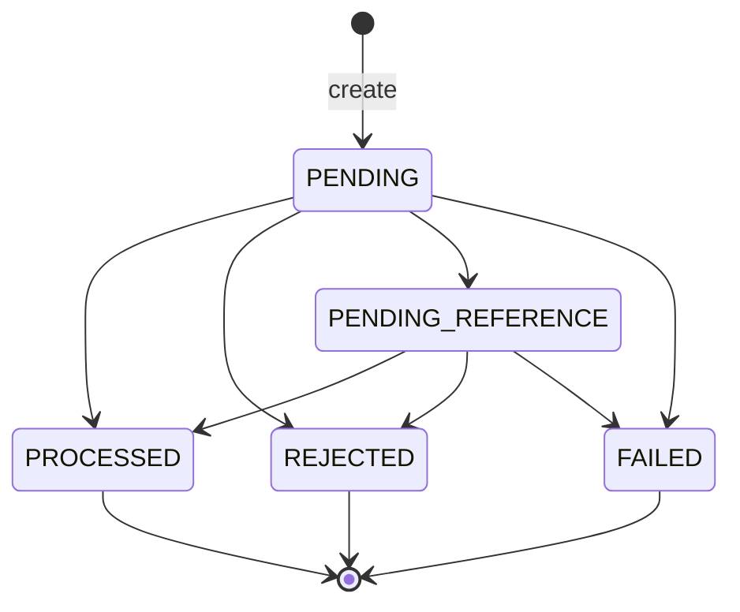

# Arquitetura

Este documento descreve o que o código **faz hoje**, o porquê de cada decisão e o que ficou de fora. Setup e comandos estão no [README.md](README.md); o enunciado está em [docs/CHALLENGE.md](docs/CHALLENGE.md).

**Índice:** [1 Visão geral](#1-visão-geral) · [2 Módulos e camadas](#2-módulos-e-camadas) · [3 Modelo de dados](#3-modelo-de-dados) · [4 Dinheiro](#4-dinheiro) · [5 Concorrência](#5-concorrência) · [6 Idempotência](#6-idempotência) · [7 Estados e failureCode](#7-máquina-de-estados-e-failurecode) · [8 Referências e reversões](#8-referências-e-reversões) · [9 HTTP](#9-http-status-e-corpo-de-erro) · [10 Mensageria](#10-mensageria) · [11 Reconciliação](#11-reconciliação) · [12 Observabilidade](#12-observabilidade) · [13 Autenticação](#13-autenticação) · [14 ORM](#14-orm-e-transações) · [15 Testes](#15-estratégia-de-testes) · [16 Falhas eliminatórias](#16-falhas-eliminatórias-do-desafio) · [17 Interpretações](#17-interpretações-adotadas) · [18 Limitações](#18-trade-offs-e-limitações-conhecidas) · [19 Próximos passos](#19-próximos-passos)

---

## 1. Visão geral

A unidade de concorrência é a **wallet**. Toda transação, venha por HTTP ou por SQS, passa pelo **mesmo caso de uso** (`ProcessWagerTransaction`), que abre uma transação SQL, trava a linha da wallet, decide o resultado, grava transação, ledger, saldo e eventos **na mesma transação**, e só então responde (HTTP) ou confirma a mensagem (SQS). Eventos de saída são publicados depois, por um processo à parte, a partir da tabela `outbox_messages`.



Os papéis (`APP_ROLES`) são ligados por instância: por padrão cada processo faz tudo (`api`, `consumer`, `outbox`, `pending-worker`), mas dá para especializar. Os workers rodam como `setTimeout` rearmado só depois do fim do tick, então nunca se sobrepõem dentro de uma instância; entre instâncias, quem arbitra é o banco.

**Fluxo de uma transação** (HTTP; pela fila só mudam o início, com o inbox, e o fim, com o ack):



---

## 2. Módulos e camadas

```
src/
  modules/
    wagering/   domain · application · infrastructure · http · messaging
    wallet/     domain · application · infrastructure · http
    messaging/  domain · application · infrastructure       (inbox, outbox, fila)
    auth/ health/
  shared/       domain (Money) · application (portas) · events · infrastructure
  config/       leitura e validação das variáveis de ambiente
```

**Regra de dependência:** `domain` não importa Nest, MikroORM nem `pg` (conferido: nenhum arquivo de `domain/` nem de `shared/domain` importa esses pacotes). A `application` fala com o banco só por **portas** (`UnitOfWork`, `WalletRepository`, `OutboxRepository`...), nunca com o ORM; ela usa do Nest apenas os decoradores de injeção (`@Injectable`, `@Inject`) e o `Logger`. ORM, SQS e HTTP vivem em `infrastructure/` e `http/`. Os agregados têm construtor `private` e fábricas estáticas (`create`, `rehydrate`), então só chegam a um estado válido pelas regras da classe.

*Por que:* o domínio é onde estão as invariantes financeiras; mantê-lo sem framework o deixa testável em milissegundos (782 testes unitários rodam em ~2 s) e troca de ORM ou de fila não toca as regras. *Trade-off:* mais arquivos (mapper, schema e repositório por agregado) do que usar entidades decoradas.

---

## 3. Modelo de dados

Duas migrations reversíveis (`up` e `down`, testadas em `schema-migration.test.ts`). As garantias abaixo valem **no banco**, independentemente de qualquer código de aplicação.

| Tabela | Para quê | Garantias no schema |
|---|---|---|
| `wallets` | Saldo atual por jogador e moeda | `balance >= 0`; `version >= 1`; moeda `^[A-Z]{3}$`; `UNIQUE (player_id, currency)` |
| `wager_transactions` | Cada transação recebida e seu resultado | `UNIQUE (idempotency_key)`; `UNIQUE (provider_id, external_transaction_id)`; `amount > 0`; `kind` e `status` em listas fechadas; `REFUND`/`ROLLBACK` exigem referência; `REJECTED` exige `failure_code`; `balance_after_amount >= 0`; índice **único parcial** de reversão única; triggers de imutabilidade |
| `wallet_ledger_entries` | Livro-razão, só inserção | `UNIQUE (transaction_id)` (uma transação gera no máximo um lançamento); `UNIQUE (wallet_id, wallet_version)` (cadeia sem bifurcação); `amount > 0`; saldos `>= 0`; **CHECK aritmético**; triggers que proíbem `UPDATE`, `DELETE` e `TRUNCATE` |
| `inbox_messages` | Mensagens SQS já vistas | `PRIMARY KEY (consumer_name, message_id)` |
| `outbox_messages` | Eventos a publicar | `attempts >= 0`; índice parcial nas pendentes; `seq bigserial` para ordem |

Detalhes que importam:

- **Reversão única:** `CREATE UNIQUE INDEX ... ON wager_transactions (reference_transaction_id) WHERE kind IN ('REFUND','ROLLBACK') AND status = 'PROCESSED'`. Duas reversões *processadas* da mesma referência são impossíveis, por qualquer tipo, mesmo se o código errar.
- **Aritmética do ledger:** `CHECK ((direction='CREDIT' AND balance_after = balance_before + amount) OR (direction='DEBIT' AND balance_after = balance_before - amount))`. Um lançamento que não fecha a conta não entra.
- **Imutabilidade:** `forbid_table_modification()` barra `UPDATE`/`DELETE` e `TRUNCATE` do ledger, e `DELETE`/`TRUNCATE` das transações. `guard_wager_transactions_update()` barra qualquer `UPDATE` de transação já terminal (`PROCESSED`, `REJECTED`, `FAILED`) e, antes disso, a alteração das colunas de identidade e de negócio (só estado, saldo observado, referência resolvida e controle de tentativas podem mudar).
- **Índices para o fluxo real:** `wager_transactions_pending_reference_idx` (`next_attempt_at` onde `PENDING_REFERENCE`), `outbox_messages_pending_idx` (`next_attempt_at` onde não publicada) e `wallet_ledger_entries_wallet_seq_idx` (paginação do ledger por wallet).
- **A primeira movimentação depois da abertura tem `wallet_version = 2`**, com ou sem lançamento de abertura (`OPENING`), para a versão nunca depender de haver saldo inicial. O helper de invariantes dos testes exige versões contíguas por wallet.

*Trade-off:* a regra "saldo da wallet == soma do ledger" **não** é uma constraint diferida; é garantida pelo lock + atomicidade e verificada por reconciliação e pelos testes (ver §11 e §18).

---

## 4. Dinheiro

`Money` (`src/shared/domain/money.ts`) guarda **centavos em `bigint`** e a moeda. Nunca há `number`, `float` ou `double` em valores monetários.

- **Formato estrito na entrada:** string que casa `^\d+\.\d{2}$` (exatamente 2 casas), moeda `^[A-Z]{3}$`. Número JSON, notação científica, vírgula, sinal, `NaN`, vazio e três casas são recusados (`400`). Valor zero é aceito pelo tipo, mas **recusado nas operações** (`amount > 0` também no banco); só o saldo inicial de uma wallet pode ser `0.00`.
- **Não arredonda.** `10.005` é rejeitado, não vira `10.01`. Arredondar em silêncio é decidir, em nome do provedor, quanto dinheiro mexeu; recusar o payload devolve a decisão a quem o enviou.
- **Limite de 18 dígitos inteiros** (`10^20 - 1` centavos), o mesmo de `numeric(20,2)`. Estourar dá `MONEY_OUT_OF_RANGE` (`400`) em vez de um erro do banco.
- **Operações** `add`, `subtract`, `negate` e comparações exigem a mesma moeda (`MONEY_CURRENCY_MISMATCH`). O objeto é congelado.
- **Persistência:** as colunas são `numeric(20,2)` e o mapeamento é feito **por string** (`moneyToColumn` / `moneyFromColumn`). O driver devolve `numeric` como texto e o `Money` o lê direto, sem passar por `number`. A API também fala em string (`"amount":"10.00"`). O teste `persistence-money-precision.test.ts` usa valores que se perderiam se passassem por `number`.

---

## 5. Concorrência

**Estratégia: lock pessimista por wallet.** O primeiro acesso de qualquer escrita é `SELECT ... FROM wallets WHERE id = ? FOR UPDATE` (`LockMode.PESSIMISTIC_WRITE`). Quem chega depois espera o commit de quem está na frente e então lê o saldo já atualizado. Não há leitura-cálculo-escrita sem trava, não há lock global, e wallets diferentes não se bloqueiam.

| Alternativa | Por que foi descartada |
|---|---|
| Lock otimista (`version` + retry) | Sob contenção alta numa wallet, o perdedor refaz todo o trabalho (lê referência, recalcula) e o número de retries cresce com a concorrência; o retry limitado vira falha para o cliente. O lock pessimista transforma a disputa numa fila no banco, sem trabalho jogado fora. |
| `UPDATE wallets SET balance = balance - ? WHERE balance >= ?` | Resolve só o débito. A transação tem mais passos que o saldo (idempotência, referência, ledger, outbox) que precisam ser consistentes entre si; o lock da linha cobre todos de uma vez. |
| `SERIALIZABLE` com retry | Funciona, mas empurra para o cliente erros de serialização imprevisíveis e é mais difícil de raciocinar e de testar de forma determinística. |

**Ordem de locks (evita deadlock):** em todos os caminhos, primeiro o inbox (só no SQS, um `INSERT ... ON CONFLICT DO NOTHING`), depois a wallet `FOR UPDATE`, e só então as leituras e escritas das transações. O worker de pendências e a reconciliação seguem a mesma ordem: **a wallet antes da transação**. A linha da transação nunca é travada antes da wallet. Cada operação trava uma única wallet.

**Rede de proteção no schema:** mesmo que alguém esquecesse o lock, `UNIQUE (wallet_id, wallet_version)` impede dois lançamentos com a mesma versão, `balance >= 0` impede saldo negativo e `UNIQUE (transaction_id)` impede lançamento duplicado.

**`lock_timeout`:** cada transação executa `SET LOCAL lock_timeout = <DB_LOCK_TIMEOUT_MS>` (padrão 5 s). Quem espera mais que isso recebe `503 LOCK_TIMEOUT` com `Retry-After: 1`; no SQS é erro transitório (a mensagem volta com backoff). Isso evita conexões penduradas atrás de uma wallet quente.

**Hot wallet.** Uma wallet muito disputada é **serializada**: o throughput dela é, no máximo, 1 / (duração da transação). É o custo consciente do lock pessimista. O replay também espera o lock (não há atalho de leitura sem lock; ver §18), o que custa latência mas garante que um replay nunca devolve estado antigo nem concorre com a primeira execução. O que se observa em produção são o histograma `wager_wallet_lock_wait_seconds` e o contador `wager_lock_timeouts_total`. Não há teste de carga, então não há número de throughput para citar.

**Prova:** wallets diferentes não se bloqueiam (um lock de teste segura uma wallet enquanto as outras concluem nos 3 processos); 50 requisições iguais e duas BETs de 80.00 sobre 100.00 em processos separados dão sempre o resultado esperado (§15).

---

## 6. Idempotência

Persistente, no banco, e válida entre instâncias. Nada em memória participa da decisão.

**`payloadHash`** (`computePayloadHash`): SHA-256 em hexadecimal de um JSON canônico com os campos
`providerId`, `externalTransactionId`, `playerId`, `walletId`, `roundId`, `gameId`, `kind`, `money` (`{amount, currency}` já normalizado em `N.NN`) e `referenceExternalTransactionId`. A canonicalização (`canonicalJson`) ordena as chaves recursivamente e descarta `undefined`, então **a ordem das chaves do JSON não muda o hash**, e `null`/ausente na referência é o mesmo. A `Idempotency-Key` **não** entra no `payloadHash`: assim o mesmo conteúdo enviado por HTTP e por SQS gera o mesmo hash.

**Duas chaves únicas** (índices do banco): `idempotency_key` e `(provider_id, external_transaction_id)`.

| Situação | Resultado |
|---|---|
| `Idempotency-Key` já existe, **mesmo** `payloadHash` | **Replay:** devolve o resultado original, sem novo efeito (`idempotentReplay: true`) |
| `Idempotency-Key` já existe, hash **diferente** | `409 IDEMPOTENCY_CONFLICT` |
| Chave nova, mas `(provider, external id)` já existe | `409 EXTERNAL_TRANSACTION_CONFLICT`, mesmo com payload idêntico |

A chave tem precedência sobre o par `(provider, external id)`.

**Replay devolve o resultado original**, inclusive `LOSS`, `REJECTED` e `422`: o saldo devolvido é o `balance_after` gravado na transação (o saldo da época). Só quando não existe (`PENDING_REFERENCE`) cai no saldo atual; se a pendência já foi resolvida, o replay devolve o estado final.

**Corrida entre wallets:** a mesma chave enviada para wallets diferentes toma locks diferentes, então as duas passam pela busca e tentam inserir. A constraint única decide: o perdedor recebe `DuplicateTransactionError`, faz rollback e **tenta uma única vez** de novo numa transação nova; agora enxerga o vencedor e vira replay ou `409`. Se violar de novo, vira `409`, nunca `500`.

**SQS:** além disso, o inbox registra `(consumer_name, message_id)`. O hash do inbox é o SHA-256 de `{idempotencyKey, payloadHash}`. Ver §10.

---

## 7. Máquina de estados e `failureCode`



`PROCESSED`, `REJECTED` e `FAILED` são terminais (o domínio recusa qualquer transição e o trigger do banco recusa o `UPDATE`). **Na prática**, `PENDING` nunca é persistida (a transição acontece antes do `INSERT`), e `FAILED` **não é produzido por nenhum caminho** (ver §18). Uma pendência que se resolve passa de `PENDING_REFERENCE` para `PROCESSED` ou `REJECTED`.

Toda rejeição vira uma linha `REJECTED` com `failure_code` estável, **persistida** e auditável, sem lançamento e sem mexer no saldo (`balance_after` = saldo no momento).

| `failureCode` | Quando | O que o provedor deve fazer |
|---|---|---|
| `INSUFFICIENT_FUNDS` | `BET` maior que o saldo | Não reenviar a mesma transação; a aposta foi recusada. |
| `REVERSAL_INSUFFICIENT_FUNDS` | `ROLLBACK` (de `WIN` ou `REFUND`) cujo débito deixaria o saldo negativo | Tratar como reversão impossível; resolver fora do sistema. |
| `CURRENCY_MISMATCH` | Moeda da operação diferente da moeda da wallet | Corrigir a moeda e enviar com **nova** transação. |
| `WALLET_PLAYER_MISMATCH` | `playerId` do payload não é o dono da wallet | Corrigir o jogador/wallet e reenviar com nova transação. |
| `REFERENCE_NOT_FOUND` | A referência nunca chegou e a espera esgotou (§8) | Enviar a transação referenciada e, se ainda fizer sentido, a reversão de novo. |
| `REFERENCE_NOT_PROCESSED` | A referência foi `REJECTED`/`FAILED`, ou existe mas nunca saiu de pendente até esgotar a espera | Nada a reverter: a referência não teve efeito. |
| `REFERENCE_KIND_NOT_ALLOWED` | Tipo da referência incompatível (ex.: `REFUND` de um `WIN`; `WIN`/`LOSS` apontando para algo que não é `BET`) | Corrigir a referência. |
| `REFERENCE_WALLET_MISMATCH` | A referência é de outra wallet | Corrigir. |
| `REFERENCE_PLAYER_MISMATCH` | A referência é de outro jogador | Corrigir. |
| `REFERENCE_CURRENCY_MISMATCH` | A referência é em outra moeda | Corrigir. |
| `REFERENCE_ROUND_MISMATCH` | A referência é de outra rodada | Corrigir. |
| `REFERENCE_AMOUNT_MISMATCH` | Valor da reversão diferente do valor da referência (reversão parcial não existe) | Reenviar com o valor exato. |
| `REFERENCE_ALREADY_REVERSED` | A referência já tem uma reversão processada | Nada a fazer: já foi revertida. |
| `PROCESSING_FAILED` | **Reservado**; definido no enum, mas nenhum caminho o emite hoje | — |

Todos os `REFERENCE_*` de divergência de contexto são decididos **na hora**, mesmo se a referência ainda estiver pendente: wallet, jogador, moeda, rodada e valor de uma transação não mudam, então esperar não adiantaria.

---

## 8. Referências e reversões

**Resolução:** a referência é buscada por `(providerId do payload, referenceExternalTransactionId)`; o mesmo id externo em outro provedor é outra transação. É lida **sem lock** (só a wallet do payload é travada: uma referência de outra wallet seria rejeitada de qualquer forma, e uma da mesma wallet já está protegida pelo lock).

**Ordem fixa das regras** (a primeira que falha define o `failureCode`, de forma determinística): precondições da wallet (jogador, moeda) → tipo da referência → wallet → jogador → moeda → rodada → valor → situação da referência → já revertida.

| Operação | Pode referenciar | Efeito no saldo |
|---|---|---|
| `BET` | — (não aceita referência: `400`) | débito |
| `WIN` | `BET` (opcional) | crédito |
| `LOSS` | `BET` (opcional) | nenhum, nem lançamento |
| `REFUND` | `BET` (obrigatório) | crédito |
| `ROLLBACK` | `BET`, `WIN` ou `REFUND` (obrigatório) | inverso da referência: `BET`→crédito, `WIN`→débito, `REFUND`→débito |

`WIN`/`LOSS` com referência não comparam valor (o prêmio não precisa igualar a aposta); `REFUND`/`ROLLBACK` exigem **valor igual** ao da referência.

**Reversão única:** a referência só pode ser revertida **uma vez, por qualquer tipo** (`REFUND` ou `ROLLBACK`). É mais estrito que o enunciado ("não pode ser revertida duas vezes pelo mesmo tipo"): uma `BET` reembolsada e depois revertida por `ROLLBACK` creditaria duas vezes o mesmo dinheiro. É regra de negócio antes de ser constraint (`REFERENCE_ALREADY_REVERSED`), e o índice único parcial é a rede de proteção. Só reversão `PROCESSED` conta: uma reversão rejeitada ou pendente não consome o direito.

**Referência fora de ordem.** Referência inexistente (ou ainda pendente) grava a transação como `PENDING_REFERENCE`, responde `202` com o saldo atual, sem lançamento, e emite `WagerTransactionPendingReference` **uma única vez**. Um worker (`PendingReferenceWorker`) a reavalia:

- Candidatas: `PENDING_REFERENCE` com `next_attempt_at <= agora`, em lotes (`PENDING_WORKER_BATCH_SIZE`, padrão 20), pelo índice parcial.
- Cada candidata roda numa transação própria: trava a wallet, **relê** a transação e a ignora se já não for devida (outra instância pode ter resolvido), reavalia pela mesma `WagerSettlement` do fluxo normal.
- **Backoff exponencial** `min(2^n s, 60 s)`: 1 s na criação, depois 2, 4, 8, 16, 32 e 60 s.
- **Limite:** 10 tentativas ou 15 minutos desde a criação (o que vier primeiro; ambos configuráveis). Com os padrões, as tentativas se esgotam em cerca de 5 minutos. Esgotado, grava `REJECTED` com `REFERENCE_NOT_FOUND` (a referência não existe) ou `REFERENCE_NOT_PROCESSED` (existe, mas nunca foi decidida) e emite `WagerTransactionRejected`.
- Se a referência chegou, o worker resolve mesmo depois do TTL: a referência vence o relógio.

*Por que esses limites:* um provedor normalmente envia a referência em segundos; esperar para sempre deixaria dinheiro em limbo. Cinco minutos cobrem atrasos de fila e reordenação sem manter pendências abertas indefinidamente. Os valores são configuráveis.

---

## 9. HTTP: status e corpo de erro

| Situação | Status | Corpo |
|---|---|---|
| Wallet criada | `201` | wallet |
| Transação `PROCESSED` (inclusive replay) | `200` | resultado |
| Transação `PENDING_REFERENCE` | `202` | resultado, `status: PENDING_REFERENCE` |
| Transação `REJECTED` (ou `FAILED`) | `422` | resultado com `failureCode` |
| Payload malformado, header ausente, valor inválido, moeda inválida | `400` | erro `{code, message}` |
| Wallet inexistente | `404` `WALLET_NOT_FOUND` | erro |
| Transação inexistente | `404` `TRANSACTION_NOT_FOUND` | erro |
| `Idempotency-Key` reutilizada com outro payload | `409` `IDEMPOTENCY_CONFLICT` | erro |
| `(provider, external id)` já usado por outra chave | `409` `EXTERNAL_TRANSACTION_CONFLICT` | erro |
| Wallet duplicada (mesmo jogador e moeda) | `409` `WALLET_ALREADY_EXISTS` | erro |
| Não obteve o lock a tempo | `503` `LOCK_TIMEOUT` + `Retry-After: 1` | erro |
| Corpo grande demais | `413` `PAYLOAD_TOO_LARGE` | erro |
| Erro inesperado | `500` `INTERNAL_ERROR` | erro genérico |

**O status vem do estado gravado**, então o replay devolve o mesmo status do original. Erro de validação não persiste nada; violação de regra de negócio (saldo, moeda, referência) **persiste** como `REJECTED` e responde `422`. O `GET` de uma transação responde `200` com o `status` no corpo mesmo que ela tenha sido rejeitada: o HTTP descreve a consulta, não o resultado do negócio.

**Corpo de erro padrão:** `{"code": "<CÓDIGO_ESTÁVEL>", "message": "<texto>"}`, produzido por um único `AllExceptionsFilter`: erros de domínio viram 400/404/409 pela categoria (`DomainError`, `NotFoundError`, `ConflictError`), `LockTimeoutError` vira 503, e o que não é reconhecido vira 500 sem vazar detalhe (o log leva só o nome do erro e os frames do stack, nunca a mensagem). `401` e `403` existem na tabela de códigos mas o `AuthGuard` atual não os produz (§13).

---

## 10. Mensageria

### Inbox

`inbox_messages` tem `PRIMARY KEY (consumer_name, message_id)`; o `message_id` é o da mensagem de negócio, não o do SQS (que muda a cada reenvio do produtor). O `INSERT ... ON CONFLICT DO NOTHING` é a **primeira operação da mesma transação SQL** do negócio, antes do lock da wallet, e `processed_at` é gravado na última, antes do commit. Rollback desfaz inbox e negócio juntos: uma linha no inbox significa "já processada", nunca "recebida mas não aplicada". Mesmo `message_id` com hash igual = já processada (confirma sem efeito); com **hash diferente** = erro permanente (`INBOX_PAYLOAD_MISMATCH`), vai para a DLQ.

**Inbox e `Idempotency-Key` são coisas diferentes.** O inbox deduplica *mensagens* (a entrega repetida do mesmo envelope pelo broker). A idempotency key deduplica *transações de negócio* (o provedor reenviando a mesma aposta num envelope novo, ou por HTTP). Um `messageId` novo com a mesma chave e o mesmo conteúdo passa pelo inbox e vira replay da transação; as duas mensagens ficam registradas.

### Consumidor (`QueueConsumer`)

Long poll (até 20 s), lote até 10, concorrência configurável. Dentro do lote, mensagens do mesmo `MessageGroupId` são processadas em ordem; grupos diferentes, em paralelo. **A correção não depende da ordem do FIFO**: o lock da wallet e o inbox garantem o resultado.

- **Ack só depois do commit:** `DeleteMessage` é a última coisa que acontece. Se o processo morre depois do commit e antes do ack, a mensagem volta após o visibility timeout e o inbox a confirma sem reaplicar (ponto de falha `consumer.after_commit_before_ack`).
- **Resultado de negócio é sempre ack:** `PROCESSED`, `REJECTED` (qualquer `failureCode`), `PENDING_REFERENCE` e replay. `REJECTED` não vai para a DLQ: é um resultado válido, já persistido.

**Classificação de erros** (`error-classifier.ts`; tabela de regras ordenadas, a primeira que casa vence):

| Classe | Erros | Destino |
|---|---|---|
| Transitório | `LockTimeoutError` (`LOCK_TIMEOUT`); erro de conexão/banco (`ECONNREFUSED`, `57P0x`, `53300`, classe `08`...; `DATABASE_UNAVAILABLE`); qualquer erro não reconhecido (`UNEXPECTED_ERROR`) | Volta à fila com backoff de visibilidade |
| Permanente | JSON malformado ou que não é objeto (`MALFORMED_MESSAGE`); `type` diferente de `WagerTransactionRequested` (`UNEXPECTED_MESSAGE_TYPE`); payload inválido, `kind` `OPENING`, qualquer outro `DomainError` (`INVALID_PAYLOAD`); wallet inexistente (`WALLET_NOT_FOUND`); `IDEMPOTENCY_CONFLICT`; `EXTERNAL_TRANSACTION_CONFLICT`; `INBOX_PAYLOAD_MISMATCH` | DLQ, com `failureReason` |
| Negócio | Rejeição por regra | Ack (ver acima) |

Na dúvida é transitório: tenta de novo e, se nunca passar, o redrive leva à DLQ.

- **Backoff por visibilidade:** `ChangeMessageVisibility` com `min(2^(n-1) × base, teto)` segundos, `n` = `ApproximateReceiveCount` (1, 2, 4, 8... até 60 s por padrão).
- **DLQ:** o limite de tentativas é o **redrive do SQS** (`maxReceiveCount = 5`, definido ao criar a fila), que move a mensagem sozinho. Os erros permanentes vão **explicitamente** à DLQ (FIFO, com `MessageGroupId` e `MessageDeduplicationId` do original e atributos `failureReason`, `sourceQueue`, `originalSqsMessageId`) e **só depois** são apagados da entrada: se o envio falhar, a mensagem volta; o pior caso é uma cópia a mais na DLQ, nunca uma perda.
- **Falha numa mensagem** devolve na hora (`ChangeMessageVisibility 0`) o resto do grupo no lote, para uma mensagem seguinte não passar à frente da que falhou.
- **Encerramento gracioso** (`SIGTERM`): para de buscar, devolve na hora as mensagens recebidas que ainda não começaram e espera as em processamento até `CONSUMER_SHUTDOWN_TIMEOUT_MS`; depois sai com código 0. O long poll em andamento **não é abortado** (abortar no cliente não cancela a requisição no SQS, que ainda poderia entregar uma mensagem a uma conexão fechada); espera-se terminar, no máximo `CONSUMER_WAIT_SECONDS`.

### Outbox e publisher

Toda mudança que gera evento o grava em `outbox_messages` **na mesma transação** do negócio. Nada publica no SQS dentro do caminho de negócio, então nenhum evento sai antes do commit, e nenhum commit confirmado perde seu evento.

Um tick do `OutboxPublisher` é uma transação curta: `SELECT ... WHERE published_at IS NULL AND next_attempt_at <= agora ORDER BY seq LIMIT <lote> FOR UPDATE SKIP LOCKED`, envia o lote com `SendMessageBatch` (fatias de 10), marca como publicadas só as **confirmadas** e dá commit. `SKIP LOCKED` faz vários publishers pegarem lotes disjuntos sem se bloquear. Mensagem não confirmada ganha `attempts`+1 e `scheduleRetry` (1, 2, 4... até 60 s); a outbox **nunca desiste** de um evento (depois de `OUTBOX_ALERT_ATTEMPTS` gera um `warn` por tentativa).

- **`MessageGroupId` = `walletId`** (os eventos de transação têm `aggregateId` = id da transação, mas a ordem que importa ao consumidor é por wallet); **`MessageDeduplicationId` = `eventId`**.
- **Crash entre envio e marcação** (`outbox.after_send_before_mark`): a transação do tick sofre rollback, a mensagem continua pendente e é reenviada. A entrega é *at-least-once*. A deduplicação do FIFO (5 min, por `eventId`) esconde a maioria dos duplicados, mas é só otimização; **os consumidores dos eventos devem deduplicar por `eventId`**. Os locks ficam abertos durante a chamada ao SQS (por isso o lote é pequeno e o SDK tem timeout curto).

### Eventos de integração

Classe abstrata `IntegrationEvent<T>` com uma subclasse por evento. Envelope: `eventId`, `eventType`, `aggregateId`, `correlationId`, `causationId`, `occurredAt`, `version`, `data`. `causationId` é a `Idempotency-Key` da transação (também no SQS, onde ela vem dentro de `data`); `correlationId` vem do contexto da requisição ou da mensagem (§12).

| Evento | Quando | `data` (principais campos) |
|---|---|---|
| `WagerTransactionProcessed` | Qualquer transação aplicada, inclusive `LOSS` e a abertura de wallet | dados da transação, `status`, `balanceAfter`, `referenceTransactionId?` |
| `WagerTransactionRejected` | Rejeição por regra, inclusive por esgotar a espera da referência | dados da transação, `status`, `failureCode` |
| `WagerTransactionPendingReference` | Referência ausente (uma vez, na criação) | dados da transação, `referenceExternalTransactionId` |
| `WalletBalanceChanged` | **Somente** quando o saldo muda | `walletId`, `transactionId`, `direction`, `money`, `balanceBefore`, `balanceAfter`, `walletVersion` |

Dados da transação = `transactionId`, `providerId`, `externalTransactionId`, `walletId`, `playerId`, `roundId`, `gameId`, `kind`, `money`, `referenceExternalTransactionId?`.

**Versionamento:** todo evento carrega `version` (hoje 1). A regra pretendida é evoluir só de forma aditiva (campos novos opcionais) e subir a `version` em mudança incompatível; não há registro de schemas nem validação formal além dos tipos. `walletVersion` permite ao consumidor reordenar `WalletBalanceChanged` de uma wallet.

---

## 11. Reconciliação

`POST /wallets/:id/reconciliation` confere `wallet.balance` contra `Σ(CREDIT) − Σ(DEBIT)` do ledger. É `POST` por contrato do enunciado, mas **só lê**.

- Trava a wallet com **`FOR SHARE`** numa única transação e calcula a soma em SQL (`numeric`, lida como texto com sinal). Todo escritor precisa do `FOR UPDATE` da wallet *antes* de gravar o ledger; como `FOR SHARE` conflita com `FOR UPDATE`, enquanto a reconciliação segura o lock ninguém altera a wallet nem insere lançamentos, e as duas leituras enxergam o mesmo estado. Reconciliações entre si não se bloqueiam.
- Divergência responde **`200` com `consistent: false`** (o pedido foi atendido; a divergência é o resultado). Um 5xx faria o cliente repetir e dispararia alarme de API quando o problema é de dado. Sinaliza em três lugares: no corpo (`difference`), no log `error` estruturado `wallet.reconciliation_mismatch` e na métrica `wager_reconciliation_mismatches_total`.
- **Nunca corrige.** Corrigir sozinho esconderia a causa e destruiria a evidência. O log não traz valores (só `walletId`, `checkedEntries` e `storedIs: ABOVE_LEDGER|BELOW_LEDGER`); os valores estão na resposta.

---

## 12. Observabilidade

**Logs (pino, JSON no stdout).** Campos fixos: `level`, `time`, `service`, `event` (nome estável), `context` (classe) e os campos do evento. O contexto de correlação mora num `AsyncLocalStorage` e entra em toda linha: `correlationId`, `messageId`, `transactionId`, `walletId`, `providerId`.

- **O que nunca é logado:** valor monetário, saldo, corpo ou payload de requisição, `Idempotency-Key`, nem **mensagens de erro** (podem carregar dados: `InvalidMoneyError` traz o valor, o erro de unicidade do Postgres traz a chave). O log leva só nome e código do erro. Além de não logar, o pino tem *redaction* como segunda defesa (`money`, `amount`, `balance`, `idempotencyKey`, `body`, `payload`, `headers`, `authorization`... no topo e um nível abaixo). Um teste percorre um fluxo completo (BET, replay, rejeição, conflito, payload inválido por HTTP e fila, retry, reconciliação divergente) e procura valores e chaves reconhecíveis em **todas** as linhas.
- **Access log mínimo:** método, caminho sem query string, status e duração. `/health` e `/metrics` não geram access log.

**Correlação.** HTTP: lê `X-Correlation-Id` (1 a 128 caracteres, `^[A-Za-z0-9][A-Za-z0-9._:-]{0,127}$`); ausente ou inválido gera um novo, e o id volta no header de toda resposta. SQS: atributo `correlationId` da mensagem (se válido), senão o `messageId`. Os eventos da outbox usam esse id. O worker de pendências e o publisher têm um contexto próprio por tick e por candidata (não herdam o id da requisição original, ver §18).

**Métricas** (`GET /metrics`, formato Prometheus, um registro por instância; labels de baixa cardinalidade, nunca `walletId`, `transactionId` nem `playerId`):

| Métrica | Tipo | Labels | O que mede |
|---|---|---|---|
| `wager_transactions_total` | counter | `kind`, `status` | Entradas em um status, contadas depois do commit |
| `wager_duplicates_total` | counter | `type` (`idempotent_replay`/`inbox_message`), `source` (`http`/`sqs`) | Duplicatas detectadas |
| `wager_retries_total` | counter | `source` (`consumer`/`outbox`/`pending_worker`) | Tentativas agendadas de novo |
| `wager_dead_letter_total` | counter | `reason` | Envios **explícitos** à DLQ |
| `wager_dlq_messages` | gauge | — | Tamanho da DLQ (`ApproximateNumberOfMessages`), lido a cada `DLQ_MONITOR_INTERVAL_MS` pelo papel `consumer`; falha na leitura mantém o último valor |
| `wager_lock_timeouts_total` | counter | — | Transações que estouraram o `lock_timeout` |
| `wager_wallet_lock_wait_seconds` | histogram | — | Espera pelo lock da wallet |
| `wager_outbox_lag_seconds` | gauge | — | Idade da pendente mais antiga da outbox (0 sem pendentes), atualizada a cada tick do publisher |
| `wager_processing_duration_seconds` | histogram | `source` (`http`/`sqs`/`worker`) | Latência do processamento |
| `wager_reconciliation_mismatches_total` | counter | — | Reconciliações com divergência |

**Health.** `GET /health/live` (processo de pé) e `GET /health/ready` (executa `select 1` no Postgres e consulta a fila de entrada no SQS, cada um com timeout de 2 s; `503` com o `checks` por dependência se alguma falhar). Ambos, e o `/metrics`, ficam fora do `AuthGuard`.

---

## 13. Autenticação

**Não foi implementada**, por decisão: o enunciado diz que autenticação não vale pontos e aceita a omissão documentada. O que existe é o **ponto de extensão**: todos os controllers de negócio usam `AuthGuard`, que chama a porta `ProviderIdentityPort.identify(request)`; a implementação atual (`AnonymousProviderIdentity`) aceita tudo e devolve `providerId: "anonymous"`. Trocar a autenticação é trocar a implementação da porta, sem tocar nos casos de uso. `/health` e `/metrics` ficam abertos; mensagens da fila são tratadas como canal interno confiável (mas passam pelas mesmas validações de domínio).

**Desenho que seria adotado:** um Identity Provider externo (Keycloak ou Zitadel), com cada provedor como *client* (`client_credentials`). O guard validaria o JWT (assinatura via JWKS, `iss`, `aud`, `exp`) e extrairia o `providerId` de uma *claim* (ou do `client_id`). A implementação de `ProviderIdentityPort` devolveria esse `providerId`, e o caso de uso passaria a **exigir que o `providerId` do payload seja igual ao da identidade** (hoje o payload é confiável). Escopos (`wagering:write`, `wallet:read`) separariam quem envia transações de quem só consulta, e a reconciliação ficaria restrita a um papel operacional. Sem tabela própria de usuários nem hash de senha.

---

## 14. ORM e transações

**MikroORM** (preferencial no enunciado): `EntityManager`, `LockMode.PESSIMISTIC_WRITE/READ` nativos para os locks, `em.transactional` e migrator com `up`/`down`.

**Domínio limpo:** as classes de domínio (`Wallet`, `WagerTransaction`, `WalletLedgerEntry`, `OutboxMessage`...) não têm decorators nem conhecem o ORM. O mapeamento é feito por **`EntitySchema` sobre tipos de registro (`*Record`) separados** e por **mappers** (`toDomain`/`toRecord`) em `infrastructure/`. As leituras desligam o identity map (`disableIdentityMap`, `refresh`) e as escritas são `insert`/`nativeUpdate` explícitos, sem *change tracking* implícito: cada `UPDATE` é exatamente o que o código escreveu. *Trade-off:* mapper e schema por agregado, em troca de nenhuma fuga de ORM para o domínio.

**Unit of Work** (`MikroOrmUnitOfWork.run`): cada execução usa um `em.fork()` próprio, abre a transação, executa `SET LOCAL lock_timeout`, entrega os repositórios daquela transação (**repositórios só existem dentro do `run`**, então é impossível gravar fora de uma transação) e traduz `55P03` em `LockTimeoutError`. O isolamento é o padrão do PostgreSQL (`READ COMMITTED`); as invariantes vêm do lock e das constraints, não do nível de isolamento.

---

## 15. Estratégia de testes

Nenhum teste de integração ou de concorrência substitui PostgreSQL ou SQS por mock: eles usam o Postgres e o LocalStack reais de `docker-compose.test.yml`.

| Camada | Quantidade | O que prova |
|---|---|---|
| **Unitário** (`test/unit`) | 802 em 47 arquivos, ~2 s | Regras puras: `Money`, `Wallet`, `WagerTransaction` (transições), política de referência, hash, classificador de erros, backoff, cursor, config, logs, métricas. Aqui há fakes, sem rede. |
| **Integração** (`test/integration`) | 767 em 43 arquivos | Schema e constraints (cada CHECK, UNIQUE e trigger), atomicidade (falha injetada depois de cada passo: nada persiste), HTTP ponta a ponta, inbox e redelivery, retry/DLQ/esgotamento, publisher concorrente, worker de pendências, reconciliação com divergência forçada por SQL, paginação, métricas e logs reais. Inclui 3 instâncias da aplicação **no mesmo processo** disputando o mesmo banco. |
| **Concorrência** (`test/concurrency`) | 15 em 7 arquivos, ~35 s | **Processos `bun src/main.ts` de verdade**: BET repetida 50 vezes e duas BETs de 80.00 sobre 100.00 em 3 processos (HTTP e SQS); wallet travada não bloqueia as outras; processo morto depois do commit e antes do ack; dois publishers e um que morre depois de enviar; reversão antes da referência com o worker em outro processo; os 3 processos mortos com `SIGKILL` no meio de uma carga e religados, com o estado final calculado antes; `SIGTERM` gracioso. |
| **Smoke do Compose** (`test/smoke`) | script | A mesma verificação contra a stack real em containers com `--scale app=3`. |
| **Carga** (`test/load`, `bun run test:load`) | experimento, ~6-7 min | Contra o Compose com 3 instâncias: 4 cenários (wallets distintas, hot wallet, tempestade de replays, misto com reversões) em 3 rodadas, com carga de concorrência fixa e aquecimento descartado. Mede vazão, p50/p95/p99, erros, espera e *timeouts* de lock (via `/metrics`) e *lag* da outbox. Ao fim de cada cenário **verifica a correção**: reconciliação de todas as wallets, saldo igual ao esperado calculado a priori, ledger e saldo por SQL, um efeito por transação externa, outbox drenada, pendências resolvidas; sai com código diferente de zero se algo falhar. Relatório em [docs/LOAD_TEST.md](docs/LOAD_TEST.md). As funções de medição (percentil, leitura de Prometheus, diferença de histogramas) têm testes unitários. |

**Helper de invariantes** (`test/support/invariants.ts`), executado ao fim de todo teste de integração e de concorrência de wallet: `wallet.balance == Σ ledger`; último `balance_after` == saldo e `wallet_version` contíguo; cada lançamento parte do saldo em que o anterior terminou; nenhuma transação não `PROCESSED` (ou `LOSS`) tem lançamento; todo lançamento tem `WalletBalanceChanged` na outbox.

**Determinismo.** Sem `sleep` fixo: toda espera é polling de estado (banco, fila, `/health/ready`, saída do processo) com *timeout* só para o teste não travar. O relógio é injetável (`ControlledClock`), os intervalos dos workers e o visibility timeout são curtos por variável de ambiente, e cada teste ganha banco (clonado de um template migrado) e filas novos. A falha é injetada por um ponto exato do código (`FaultInjector`): em integração, por exceção; nos testes de processos, o processo mata a si mesmo com `SIGKILL` (`ENABLE_FAULT_INJECTION` + `FAULT_POINT`, só para teste; a configuração recusa o ponto sem a flag). Os testes que dependem de erros de rede reais usam o banco de verdade (`allow_connections false` + `pg_terminate_backend`) e locks reais segurados por uma conexão de teste. **Limitação:** a deduplicação do FIFO esconde reenvios do publisher, então a contagem exata de envios é provada nos testes de integração com um decorador contador; nos testes de processos prova-se que nada se perde.

---

## 16. Falhas eliminatórias do desafio

| Falha (§14 do enunciado) | Como o projeto evita | Onde está | Quem prova |
|---|---|---|---|
| `number` para dinheiro | `Money` em `bigint` (centavos), API em string, `numeric(20,2)` mapeado por string; valores com mais de 2 casas ou fora do formato são rejeitados | `src/shared/domain/money.ts`, `src/shared/infrastructure/database/mapping.ts` | `test/unit/money.test.ts`; `persistence-money-precision.test.ts` |
| Saldo negativo por race | `FOR UPDATE` na wallet antes de qualquer decisão; `CHECK (balance >= 0)` e `CHECK (balance_after >= 0)` no schema; `UNIQUE (wallet_id, wallet_version)` | `process-wager-transaction.ts`, `mikro-orm-wallet.repository.ts`, migration `create_schema` | `wagering-concurrency.test.ts` (5 apostas de 30.00 sobre 100.00: só 3 cabem; 10 rodadas de 2×80.00); `schema-wallets.test.ts`; `concurrency/multi-instance-http.test.ts` e `multi-instance-sqs.test.ts` (3 processos) |
| Débito ou crédito duplicado | `UNIQUE (idempotency_key)` e `UNIQUE (provider_id, external_transaction_id)`; lançamento `UNIQUE (transaction_id)`; inbox `PRIMARY KEY (consumer_name, message_id)`; ack só depois do commit | migration `create_schema`, `payload-hash.ts`, `mikro-orm-inbox.repository.ts` | `wagering-concurrency.test.ts` (1 execução e 49 replays); `inbox-concurrency.test.ts`; `schema-ledger.test.ts`; `concurrency/crash-after-commit.test.ts`; `concurrency/restart-consistency.test.ts` |
| Idempotência apenas em memória | A decisão é sempre uma consulta ao banco (chaves únicas + inbox); nenhum cache de idempotência na aplicação | `process-wager-transaction.ts` (`findKnown`, `tryReceive`) | `concurrency/restart-consistency.test.ts` (todos os processos mortos e as mesmas chaves reenviadas: um efeito por transação); `crash-after-commit.test.ts` |
| Correta só com uma instância | O arbitro é o banco (lock de linha, constraints, `SKIP LOCKED`), não a aplicação; workers idempotentes entre instâncias | `mikro-orm-outbox.repository.ts` (`SKIP LOCKED`), `pending-reference-worker.ts` (relê sob o lock) | `test/concurrency/*` (3 processos reais); `outbox-publisher-concurrency.test.ts`; `pending-reference-worker-concurrency.test.ts`; `bun run smoke:scale` na stack em containers |
| Publicar evento antes do commit | O evento é uma linha da outbox na mesma transação; só o publisher envia ao SQS, e ele lê apenas linhas commitadas | `wager-settlement.ts` (`publish*`), `outbox-publisher.ts` | `outbox-publisher.test.ts` ("só enxerga o que já foi commitado": com a transação aberta nada sai; com rollback, nada é publicado nunca); `wagering-http-faults.test.ts` (falha no meio: nada persiste, nem evento) |
| Ausência de ledger auditável | `wallet_ledger_entries` só aceita inserção (triggers contra `UPDATE`/`DELETE`/`TRUNCATE`), com CHECK aritmético e cadeia de versões; transações rejeitadas também são gravadas; reconciliação | migration `create_schema`, `reconcile-wallet.ts` | `schema-ledger.test.ts` (imutabilidade e aritmética); `invariants.test.ts`; `wallet-reconciliation.test.ts` |
| Testes que substituem Postgres e SQS por mocks | Integração e concorrência usam Postgres e LocalStack reais em containers; falhas de rede e de banco são reais | `docker-compose.test.yml`, `test/support/*` | Toda a pasta `test/integration` e `test/concurrency`. Os fakes existem só em testes unitários de lógica pura (ex.: `queue-consumer.test.ts`) |

---

## 17. Interpretações adotadas

Onde o enunciado era omisso ou ambíguo, estas foram as escolhas (uma linha cada).

**Entrada e dinheiro**
- `Idempotency-Key` ausente ou vazia: `400`. Limite de 255 caracteres em chaves e identificadores de texto.
- Valor `0.00` é rejeitado nas operações (`amount > 0`); só o saldo inicial pode ser zero.
- Mais de 2 casas decimais é rejeitado, não arredondado.
- `BET` com `referenceExternalTransactionId` e `REFUND`/`ROLLBACK` sem ele são `400`; `null` conta como ausente.
- `OPENING` é interno: não pode ser enviado pela API nem pela fila.
- Payload malformado: `400` e não persiste. Violação de regra de negócio: persiste como `REJECTED`.
- Wallet inexistente: `404`, não persiste (na fila, erro permanente).

**Idempotência**
- A `Idempotency-Key` tem precedência sobre `(provider, external id)`.
- O replay devolve o resultado original, inclusive o saldo da época e o `422` de uma rejeição.
- Reutilizar `opening:{walletId}` ou imitar o provedor `internal` dá `409`: a abertura ocupa essas chaves.

**Wallet e transações**
- `playerId` do payload diferente do dono da wallet: `REJECTED WALLET_PLAYER_MISMATCH`; moeda diferente: `REJECTED CURRENCY_MISMATCH`. As duas valem antes de qualquer regra de referência ou de saldo.
- Saldo inicial positivo gera uma transação `OPENING` (`provider_id = internal`) e um lançamento; saldo zero não gera nada. Wallet duplicada (jogador e moeda) é `409`.
- `LOSS` não move saldo, não gera lançamento nem `WalletBalanceChanged`.

**Referências e reversões**
- Reversão exige valor igual ao da referência; não há reversão parcial.
- Cada referência é revertida uma vez por **qualquer** tipo (mais estrito que o enunciado), contando só reversões `PROCESSED`.
- `REFUND` só reverte `BET`; `ROLLBACK` reverte `BET`, `WIN` ou `REFUND`; `LOSS`, `ROLLBACK` e `OPENING` não são revertíveis.
- `WIN`/`LOSS` aceitam referência opcional a uma `BET`; se informada, segue as mesmas regras de pendência e rejeição.
- Reversão que deixaria o saldo negativo: `REJECTED REVERSAL_INSUFFICIENT_FUNDS`, persistida e auditável.
- Referência `REJECTED`/`FAILED`: `REJECTED REFERENCE_NOT_PROCESSED`. Referência pendente: a transação continua `PENDING_REFERENCE`.
- Esgotada a espera: `REFERENCE_NOT_FOUND` se a referência não existe; `REFERENCE_NOT_PROCESSED` se existe e nunca foi decidida. O TTL conta desde a criação e é inclusivo.

**Mensageria**
- Mesmo `messageId` com hash diferente no inbox é erro permanente (DLQ). `messageId` novo com a mesma chave e conteúdo é replay.
- O `messageId` do inbox é o do corpo da mensagem, não o do SQS.
- Resultado de negócio (inclusive `REJECTED`) é ack; só erros permanentes vão à DLQ.
- Na dúvida, o erro é transitório.
- A DLQ recebe o corpo intacto, com `failureReason`.
- Eventos vão para uma fila separada (`wager-events.fifo`), nunca para a de entrada; a configuração recusa que sejam a mesma.
- `MessageGroupId` dos eventos é o `walletId`; deduplicação por `eventId`.

**HTTP**
- `PROCESSED` `200`; `PENDING_REFERENCE` `202`; `REJECTED`/`FAILED` `422`; o replay repete o status original.
- Consulta de transação responde `200` com o `status` no corpo.
- Divergência de reconciliação responde `200` com `consistent: false`.

**Operação**
- Instâncias com papéis ligados por `APP_ROLES`; a migração roda em um serviço de execução única.
- `/metrics` sem autenticação, como o `/health`.
- Cada teste usa banco e filas próprios; a falha de processo é injetada por variável de ambiente.

---

## 18. Trade-offs e limitações conhecidas

Sem maquiagem:

| Limitação | Consequência |
|---|---|
| **`FAILED` não é persistido** (a mensagem SQS que esgota as tentativas vai à DLQ, e a DLQ é o registro). O status e o código `PROCESSING_FAILED` existem, mas nada os produz. | Não há linha `FAILED` auditável no banco para esse caso; é preciso olhar a DLQ. |
| **Ordem por wallet entre vários publishers não é garantida de ponta a ponta** | Um publisher pode enviar eventos novos de uma wallet enquanto outro segura (ou reenvia) um mais antigo. O consumidor dos eventos deve deduplicar por `eventId` e usar `walletVersion` para reordenar. |
| **Mensagens que o SQS move sozinho para a DLQ (esgotando `maxReceiveCount`) não entram em `wager_dead_letter_total`**, porque a aplicação não as vê | O tamanho real da DLQ aparece no gauge `wager_dlq_messages` (aproximado, só mensagens visíveis). |
| **O worker de pendências usa um `SELECT` simples, sem `SKIP LOCKED`** | Várias instâncias enxergam as mesmas candidatas e a disputa é resolvida pelo lock da wallet + releitura (correto, mas com trabalho repetido). Uma candidata que falha sempre (ex.: `lock_timeout`) sem alterar a linha continua no início do lote ordenado e pode ocupar vagas. |
| **O worker não reaproveita o `correlationId` da requisição original** | A transação não guarda esse id; o elo é pelo `transactionId` e `causationId`. |
| **O long poll em andamento não é abortado no encerramento** | O shutdown pode levar até `CONSUMER_WAIT_SECONDS` (20 s por padrão). Se estourar `CONSUMER_SHUTDOWN_TIMEOUT_MS`, as mensagens em processamento voltam pelo visibility timeout. |
| **Cursor do ledger não é assinado** | Um cursor forjado só muda de onde se lê o ledger **da própria wallet** (a consulta sempre filtra por `wallet_id`); nada vaza. Quem chegou ao fim (`nextCursor: null`) precisa recomeçar para ver lançamentos novos. |
| **`/metrics` sem autenticação** | Em produção deve ficar restrito à rede interna. Os registros são por instância; o gauge `wager_outbox_lag_seconds` é o último tick de cada instância. |
| **Sem atalho de replay fora do lock** | O replay também espera o lock da wallet: latência a mais numa hot wallet, em troca de nunca devolver estado antigo. |
| **Hot wallet serializada**, e o publisher segura locks abertos durante a chamada ao SQS (lote pequeno, timeout curto) | Throughput por wallet limitado pela duração da transação. Medido em [docs/LOAD_TEST.md](docs/LOAD_TEST.md): ~208 req/s numa hot wallet contra ~906 req/s em wallets distintas (24 trabalhadores, 3 instâncias, tudo na mesma máquina), com quase toda a latência sendo fila para o lock. Nenhum 503 nem *lock timeout* nesse experimento. |
| **A entrega de eventos pela outbox é muito mais lenta que a API com a configuração padrão** | O publicador envia um lote de 10 por ciclo de 1 s em cada instância: ~30 eventos/s com 3 instâncias, contra 200–900 req/s aceitas pela API. No teste de carga o *lag* chegou a 25–38 s e a outbox levou 29–40 s para esvaziar; nada se perde, mas sob carga sustentada o atraso cresce. `OUTBOX_BATCH_SIZE` e `OUTBOX_INTERVAL_MS` existem, mas não foram exploradas. |
| **O teste de carga é um experimento limitado** | Modelo *closed-loop* (sofre de *coordinated omission*: a latência medida é otimista), gerador e sistema na mesma máquina, cenários de segundos, só pelo HTTP, uma única configuração. Os números não se transferem para outro ambiente nem provam capacidade; ver [docs/LOAD_TEST.md](docs/LOAD_TEST.md) §4 e §7. |
| **A regra "saldo == ledger" não é constraint diferida** | É garantida por lock + atomicidade, conferida por reconciliação e pelos testes; um `UPDATE` direto no saldo por quem tem acesso ao banco passa (e a reconciliação o acusa). |
| **Sem autenticação**; o `providerId` do payload é confiável | Ver §13. |
| **`wager_transactions_total` conta entradas em status** | Uma pendência que se resolve conta duas vezes (`PENDING_REFERENCE` e depois `PROCESSED`/`REJECTED`). |
| **Mensagens de erro nunca vão para o log** (só nome e código) | Diagnóstico mais pobre, em troca de nunca vazar valor ou chave. |
| **LocalStack não persiste filas** | Parar o LocalStack descarta as mensagens enfileiradas. Não ocorre na AWS real. |
| **Não implementados:** ledger de partidas dobradas, OpenTelemetry, trigger diferida de consistência wallet↔ledger | Itens opcionais/diferenciais deixados de fora para priorizar correção e testes. |
| **Faixa de portas limita a 10 instâncias no Compose** e não há balanceador | Escolha para manter cada instância endereçável nos testes de escala. |
| **Cobertura do SIGTERM** | O teste roda em Linux (container) e é pulado no Windows. |

---

## 19. Próximos passos

Se houvesse mais tempo, nesta ordem:

1. **Persistir `FAILED`** para mensagens que esgotam as tentativas com a transação já identificada (hoje só a DLQ guarda isso) e emitir o evento correspondente.
2. **Aumentar a capacidade da outbox** (publicar enquanto houver pendentes no mesmo ciclo, ou lotes e frequência maiores) e repetir o teste de carga para ver o efeito; ampliar o teste de carga com chegadas em taxa fixa (*open-loop*), carga longa e a entrada pela fila SQS. O teste atual (`bun run test:load`, [docs/LOAD_TEST.md](docs/LOAD_TEST.md)) já mede o custo da hot wallet e o atraso da outbox.
3. **Autenticação** com IdP externo (§13), incluindo a checagem `providerId` do payload × identidade.
4. **`SKIP LOCKED` (ou reivindicação por lease) no worker de pendências**, e guardar o `correlationId` original na transação.
5. **Trigger diferida** (`DEFERRABLE INITIALLY DEFERRED`) que confira `wallet.balance` contra o ledger no commit, como defesa em profundidade.
6. **OpenTelemetry** (traces entre HTTP, fila, outbox e eventos) e dashboard das métricas existentes.
7. **Registro formal de schemas dos eventos** e verificação de compatibilidade.
8. **Ledger de partidas dobradas** se o produto passar a precisar de contrapartida contábil.
