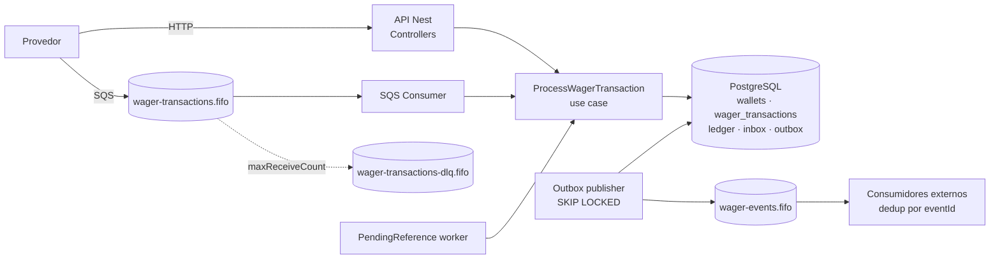
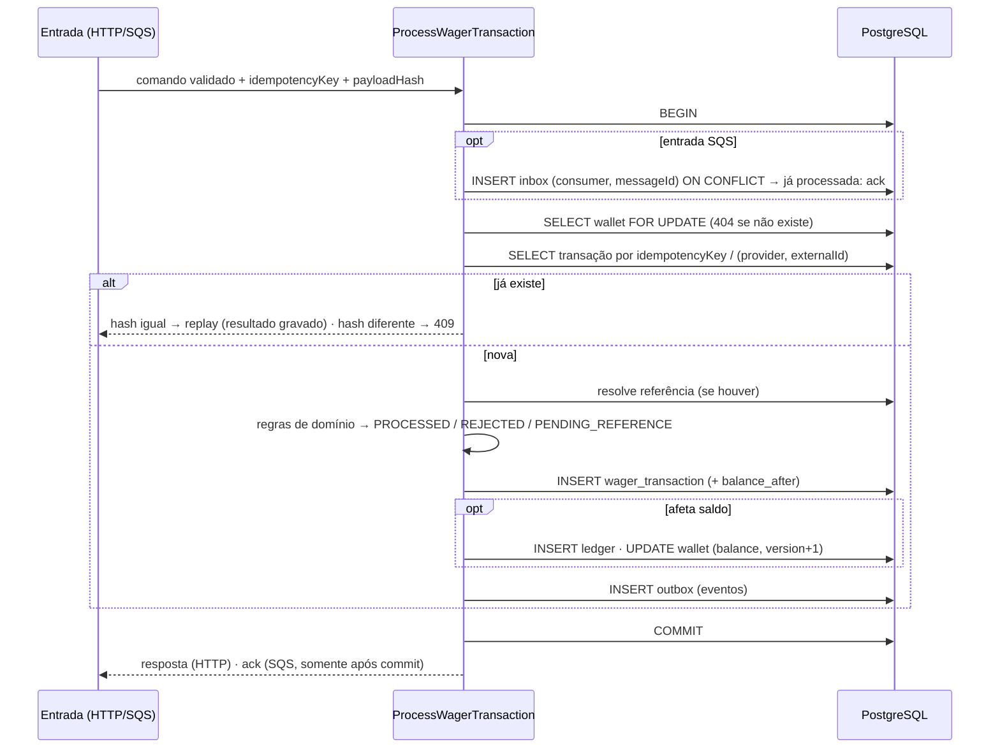

# Plano de implementação — Distributed Wagering Processor

> Base: `docs/CHALLENGE.md` e `docs/requirements.md`. Prazo: **3 dias**. Entrega: link do repositório.
> Este plano não contém código; ele alimenta o `ARCHITECTURE.md`.

---

## 0. Premissas

### 0.1 Decisões já tomadas
| # | Decisão |
|---|---|
| D1 | HTTP **síncrono**: processa e responde com o resultado. `202` só para `PENDING_REFERENCE`. |
| D2 | Outbox publica em fila SQS **separada** (`wager-events.fifo`), nunca em `wager-transactions.fifo`. |
| D3 | Unicidade em `idempotency_key` **e** em `(provider_id, external_transaction_id)`. |
| D4 | Uma transação referenciada só pode ser revertida **uma vez**, por qualquer tipo (`REFUND` ou `ROLLBACK`). |
| D5 | `Money`: exatamente 2 casas decimais (sem arredondar); valor **zero rejeitado** nas operações. |
| D6 | Payload malformado → `400`, não persiste. Violação de regra de negócio → persistida como `REJECTED` + `failureCode`. |
| D7 | Referência existente mas inválida → `REJECTED` com `failureCode` distinto por caso. Referência ainda pendente → continua aguardando. |
| D8 | Saldo resultante gravado na própria transação (replay devolve o resultado original, inclusive `LOSS`/`REJECTED`). |
| D9 | Sem autenticação: `AuthGuard` no-op + seção no `ARCHITECTURE.md`. |
| D10 | Concorrência: `SELECT ... FOR UPDATE` por wallet + constraints de unicidade. |

### 0.2 Premissas adicionais (derivadas, documentar no ARCHITECTURE.md)
| # | Premissa | Motivo |
|---|---|---|
| P1 | `walletId` inexistente → `404`, não persiste (SQS: erro permanente → DLQ). | Não há wallet para a FK nem saldo para registrar. |
| P2 | `playerId` do payload ≠ dono da wallet → `REJECTED` `WALLET_PLAYER_MISMATCH`. | Wallet existe; é regra de negócio auditável (D6). |
| P3 | Moeda da operação ≠ moeda da wallet → `REJECTED` `CURRENCY_MISMATCH`. | D6 cita moeda como regra de negócio. |
| P4 | `WIN`/`LOSS` aceitam `referenceExternalTransactionId` **opcional**; se informado, deve apontar para `BET` da mesma rodada/wallet/player/moeda, com as mesmas regras de pendência/rejeição. | "pode referenciar a BET" (§7). |
| P5 | Referenciada em `REJECTED`/`FAILED` → `REJECTED` `REFERENCE_NOT_PROCESSED`. Referenciada em `PENDING`/`PENDING_REFERENCE` → continua `PENDING_REFERENCE`. | Complementa D7. |
| P6 | `OPENING`: `provider_id = 'internal'`, `external_transaction_id = walletId`, `idempotency_key = 'opening:{walletId}'`, `round_id = game_id = 'opening'`. Emite `WagerTransactionProcessed` e `WalletBalanceChanged`. | Campos obrigatórios no modelo; muda saldo → evento. |
| P7 | Replay de transação `PENDING_REFERENCE` devolve o **estado atual** (se já foi resolvida, devolve o resultado final). | Única forma de o provedor descobrir o desfecho pela mesma key. |
| P8 | `FAILED` = mensagem SQS que esgota tentativas por erro de infraestrutura e já tinha a transação identificada; é registrada como `FAILED` (auditável) e vai para a DLQ. | Dá uso concreto ao status sem conflitar com o HTTP síncrono. |
| P9 | Mesmo `messageId` com `payloadHash` diferente no inbox → erro permanente → DLQ + métrica. | Indica produtor quebrado; não é replay. |
| P10 | `Idempotency-Key` ausente ou vazio → `400`. | "obrigatório" (§9). |

---

## 1. Arquitetura proposta

**Monólito modular** NestJS em camadas hexagonais (domínio → aplicação → adaptadores). Uma única imagem, com **papéis ativados por env** (`APP_ROLES=api,consumer,outbox,pending-worker`, padrão: todos). Assim qualquer instância pode assumir qualquer trabalho, que é o requisito de múltiplas instâncias.

### 1.1 Módulos

| Módulo | Responsabilidade |
|---|---|
| `shared` | `Money`, erros de domínio, `Clock`, gerador de IDs (UUID v7), `IntegrationEvent`, `UnitOfWork` (porta), logger, métricas, config. |
| `wallet` | Aggregate `Wallet`, `WalletLedgerEntry`, abertura de wallet, consultas de wallet/ledger, reconciliação. |
| `wagering` | `WagerTransaction` (máquina de estados), `FailureCode`, política de referência, use case **`ProcessWagerTransaction`** (único ponto de entrada para HTTP e SQS), `payloadHash`, worker de `PENDING_REFERENCE`, consultas de transação. |
| `messaging` | `InboxMessage`, `OutboxMessage`, consumidor SQS, publisher da outbox, classificação de erros, shutdown gracioso. |
| `health` | `/health/live`, `/health/ready` (ping PostgreSQL + `GetQueueAttributes` SQS). |
| `auth` | `AuthGuard` no-op + `ProviderIdentityPort` (ponto de extensão). |
| `observability` | logger JSON (pino), `/metrics` (prom-client), propagação de `correlationId`. |

Portas (interfaces na aplicação, implementadas na infra): `WalletRepository`, `WagerTransactionRepository`, `LedgerRepository`, `InboxRepository`, `OutboxRepository`, `UnitOfWork`, `EventPublisher` (SQS), `Clock`, `IdGenerator`, `FaultInjector` (no-op em produção; usado nos testes de crash).

### 1.2 Componentes



### 1.3 Fluxo de processamento (uma transação SQL)



Pontos-chave:
- O lock da wallet **serializa** todas as operações da mesma wallet entre instâncias. Wallets diferentes não disputam lock (sem lock global).
- A checagem de idempotência acontece **depois** do lock. Dentro da mesma wallet, a segunda requisição enxerga a primeira já commitada. Entre wallets diferentes (mesma key com outro `walletId`), quem protege é a **constraint única**: violação → rollback → reler → replay/409.
- **Fast path** opcional: consulta de idempotência sem lock antes do `BEGIN`, para replays baratos.

### 1.4 Eventos
| Evento | Emitido quando | `aggregateId` |
|---|---|---|
| `WagerTransactionProcessed` | transação → `PROCESSED` (inclui `LOSS`, `OPENING`) | `transactionId` |
| `WagerTransactionRejected` | transação → `REJECTED` (inclusive por esgotar referência) | `transactionId` |
| `WalletBalanceChanged` | somente com lançamento no ledger | `walletId` |
| `WagerTransactionPendingReference` | **primeira** entrada em `PENDING_REFERENCE` (não a cada retry) | `transactionId` |

`correlationId`: header `X-Correlation-Id` ou gerado (HTTP), atributo da mensagem ou `messageId` (SQS). `causationId`: `messageId` ou `idempotencyKey`. Publicação em `wager-events.fifo` com `MessageGroupId = walletId` e `MessageDeduplicationId = eventId` (otimização; consumidores devem deduplicar por `eventId`).

---

## 2. Estrutura de pastas

```
.
├── docker-compose.yml            # postgres, localstack, app (escalável)
├── docker-compose.test.yml       # infra para testes de integração
├── localstack/init/              # criação das filas + redrive policy
├── migrations/                   # MikroORM, up/down
├── src/
│   ├── main.ts
│   ├── app.module.ts
│   ├── config/
│   ├── shared/
│   │   ├── domain/               # money.ts, domain-error.ts, clock.ts, id.ts
│   │   ├── events/               # integration-event.ts
│   │   ├── application/          # unit-of-work.port.ts, fault-injector.port.ts
│   │   └── infrastructure/       # database/, sqs/, logging/, metrics/
│   ├── modules/
│   │   ├── wallet/
│   │   │   ├── domain/           # wallet.ts, wallet-ledger-entry.ts, ledger-direction.ts
│   │   │   ├── application/      # open-wallet, get-wallet, list-ledger, reconcile-wallet
│   │   │   ├── infrastructure/   # schemas, repositórios, mappers
│   │   │   └── http/             # controller, DTOs/validação
│   │   ├── wagering/
│   │   │   ├── domain/           # wager-transaction.ts, failure-code.ts, reference-policy.ts, events/
│   │   │   ├── application/      # process-wager-transaction, payload-hash, retry-pending-references, queries
│   │   │   ├── infrastructure/
│   │   │   ├── http/
│   │   │   └── messaging/        # wager-transaction.consumer.ts
│   │   ├── messaging/
│   │   │   ├── domain/           # inbox-message.ts, outbox-message.ts
│   │   │   ├── application/      # outbox-publisher.ts, error-classifier.ts
│   │   │   └── infrastructure/
│   │   ├── health/
│   │   └── auth/                 # auth.guard.ts (no-op), provider-identity.port.ts
├── test/
│   ├── unit/
│   ├── integration/
│   ├── concurrency/
│   ├── load/                     # opcional
│   └── support/                  # spawn de instâncias, fixtures, asserts de invariantes
├── docs/                         # CHALLENGE.md, requirements.md, plan.md
├── README.md
└── ARCHITECTURE.md
```

---

## 3. Decisões técnicas

| Tema | Alternativas | Escolha | Trade-off |
|---|---|---|---|
| **ORM** | MikroORM · TypeORM | **MikroORM** com `EntitySchema` (sem decorators no domínio) + mappers `rehydrate` | Domínio limpo e `em.transactional()`/`LockMode`. Custo: camada de mapeamento. Risco de compatibilidade com Bun (ver §6). |
| **Mapeamento domínio ↔ persistência** | entidades de domínio mapeadas direto · records + mappers | **Records + mappers** | Construtor privado e `rehydrate` preservados. Mais código, menos mágica. |
| **Dinheiro (memória)** | `decimal.js`/`big.js` · `BigInt` em centavos | **`BigInt` em unidades mínimas (escala 2)** | Exato, zero dependência, impossível cair em `number`. Escala fixa em 2 para todas as moedas, o que o desafio já assume. |
| **Dinheiro (banco)** | `bigint` centavos · `numeric(20,2)` | **`numeric(20,2)` + `char(3)` de moeda** | Legível em SQL e na reconciliação; o driver devolve string, que é convertida sem passar por `number`. |
| **Validação de entrada** | arredondar · rejeitar | **Rejeitar** se não casar `^\d+\.\d{2}$` e se `= 0` | Contrato estrito (D5); provedor corrige o payload. |
| **Idempotência** | cache · tabela separada · colunas únicas na transação | **`UNIQUE(idempotency_key)` + `UNIQUE(provider_id, external_transaction_id)`** na própria `wager_transactions`, com resultado gravado (D3, D8) | Persistente e transacional. Uma linha por pedido, inclusive `REJECTED`. |
| **payloadHash** | hash do body cru · JSON canônico | **SHA-256 hex** de JSON canônico (chaves ordenadas, sem espaços) de `providerId, externalTransactionId, playerId, walletId, roundId, gameId, kind, money{amount,currency}, referenceExternalTransactionId?` (omitido se ausente) | Mesmo hash para HTTP e SQS, o que permite replay entre canais. `idempotencyKey`, headers e `messageId` ficam fora. |
| **Concorrência** | optimistic (version) · update condicionado · pessimista | **`SELECT ... FOR UPDATE` na wallet** + `lock_timeout` (ex.: 5s) → `503` | Simples, correto com N instâncias, sem tempestade de retry em hot wallet. Custo: serializa a mesma wallet (aceitável; a unidade de concorrência é a wallet). `version` mantido como informação e como chave do ledger. |
| **Reversão única** | checagem em código · constraint | **Índice único parcial** `reference_transaction_id WHERE kind IN ('REFUND','ROLLBACK') AND status='PROCESSED'` | Garantia no schema (D4), não só em código. |
| **Fila de entrada** | standard · FIFO | **FIFO**, `MessageGroupId = walletId`, `MessageDeduplicationId = messageId` | Reduz corrida e duplicata, mas a garantia é do banco (restrição 3). |
| **Dedup SQS** | só FIFO · inbox | **Inbox** `PK(consumer_name, message_id)` na mesma transação | Sobrevive a redelivery depois do commit. |
| **Erros no consumidor** | — | Negócio → `REJECTED` + ack · Transitório → não ack + `ChangeMessageVisibility` com backoff · Permanente (malformado, wallet inexistente, hash de inbox divergente) → DLQ · esgotou tentativas → `FAILED` (P8) + DLQ via redrive (`maxReceiveCount = 5`) | Provedor e operação distinguem "corrigir" de "esperar". |
| **Outbox** | lease com coluna `claimed_until` · `FOR UPDATE SKIP LOCKED` | **`SKIP LOCKED` em lote pequeno** dentro de transação curta; marca `published_at` após o envio; falha → `scheduleRetry` (backoff exponencial com teto) | Simples e seguro com vários publishers. Crash entre envio e marcação → reenvio (at-least-once, dedup por `eventId`). Custo: transação aberta durante a chamada SQS, mitigada pelo lote pequeno e timeout. |
| **PENDING_REFERENCE** | só retry no worker · resolver também na chegada da referência | **Worker agendado** (`SKIP LOCKED` sobre `next_attempt_at`), backoff `2^n s` com teto de 60s, **máx. 10 tentativas ou TTL de 15 min** → `REJECTED` `REFERENCE_NOT_FOUND` | Requisito literal (§7.1). Resolução imediata na chegada da referência fica como otimização opcional. |
| **Status HTTP** | — | `201` wallet criada · `200` `PROCESSED` (e replay) · `202` `PENDING_REFERENCE` · `400` payload inválido · `404` recurso inexistente · `409` conflito (idempotência / wallet duplicada), com `code` distinto no corpo · `422` `REJECTED` (corpo com `failureCode`, `transactionId`, `balance`) · `503` falha transitória + `Retry-After` | Cada situação tem um código; replay devolve o mesmo status do original, com `idempotentReplay: true`. |
| **Ledger: paginação** | offset · cursor | **Cursor opaco** = base64url do `seq` (bigserial), ordem crescente, `limit` padrão 50 e máx. 200 | Estável sob inserções concorrentes. |
| **Logs / métricas** | — | **pino** (JSON) · **prom-client** em `/metrics` | Leves e compatíveis com Bun. OpenTelemetry é opcional. |
| **Testes de integração** | Testcontainers · Compose dedicado | **`docker-compose.test.yml`** + banco isolado por suíte | Menos risco com Bun; Testcontainers fica como alternativa. |

### 3.1 Schema e constraints (resumo para o ARCHITECTURE.md)

**`wallets`**: `id uuid PK`, `player_id`, `currency char(3)`, `balance numeric(20,2) CHECK (balance >= 0)`, `version int CHECK (version >= 1)`, `created_at`, `updated_at`. `UNIQUE(player_id, currency)`.

**`wager_transactions`**: `id`, `provider_id`, `external_transaction_id`, `idempotency_key UNIQUE`, `payload_hash`, `wallet_id FK`, `player_id`, `round_id`, `game_id`, `kind CHECK IN (...)`, `amount numeric(20,2) CHECK (amount > 0)`, `currency`, `reference_external_transaction_id`, `reference_transaction_id FK self`, `status CHECK IN (...)`, `failure_code`, `balance_after_amount numeric(20,2)` (snapshot para replay, D8), `reference_attempts`, `next_attempt_at`, `created_at`, `processed_at`.
- `UNIQUE(provider_id, external_transaction_id)`
- `CHECK (kind NOT IN ('REFUND','ROLLBACK') OR reference_external_transaction_id IS NOT NULL)`
- `CHECK (status <> 'REJECTED' OR failure_code IS NOT NULL)`
- índice único parcial de reversão única (D4)
- índice parcial `(next_attempt_at) WHERE status = 'PENDING_REFERENCE'`
- **trigger**: bloqueia `UPDATE` quando o status antigo é terminal e qualquer alteração em colunas de negócio; bloqueia `DELETE`.

**`wallet_ledger_entries`**: `seq bigserial`, `id`, `wallet_id FK`, `transaction_id FK`, `direction CHECK`, `amount CHECK (> 0)`, `currency`, `balance_before CHECK (>= 0)`, `balance_after CHECK (>= 0)`, `wallet_version`, `created_at`.
- `UNIQUE(transaction_id)` (no máximo um lançamento por transação)
- `UNIQUE(wallet_id, wallet_version)` (cadeia sem bifurcação)
- `CHECK` aritmético: `CREDIT → after = before + amount`, `DEBIT → after = before - amount`
- **trigger** que rejeita `UPDATE`/`DELETE` (imutabilidade estrutural, restrição 5)

**`inbox_messages`**: `PK(consumer_name, message_id)`, `payload_hash`, `received_at`, `processed_at`.

**`outbox_messages`**: `id PK`, `seq bigserial`, `aggregate_id`, `event_type`, `payload jsonb`, `occurred_at`, `attempts`, `next_attempt_at`, `published_at`. Índice parcial `(next_attempt_at) WHERE published_at IS NULL`.

Opcional: constraint trigger diferida que confere `wallets.balance = último balance_after do ledger` no commit.

### 3.2 Taxonomia de `failureCode` (inicial)
| Código | Quando | O que o provedor faz |
|---|---|---|
| `INSUFFICIENT_FUNDS` | `BET` sem saldo | desiste ou reenvia com novo id |
| `REVERSAL_INSUFFICIENT_FUNDS` | reversão deixaria saldo negativo (regra 9) | escala para operação/suporte |
| `CURRENCY_MISMATCH` | moeda ≠ wallet | corrige o payload (novo id) |
| `WALLET_PLAYER_MISMATCH` | player ≠ dono da wallet | corrige o payload |
| `REFERENCE_NOT_FOUND` | referência não chegou dentro do limite/TTL | investiga; desiste |
| `REFERENCE_KIND_NOT_ALLOWED` | `REFUND` → não-`BET`; `ROLLBACK` → `LOSS`/`ROLLBACK`/`OPENING`; `WIN`/`LOSS` → não-`BET` | corrige |
| `REFERENCE_ROUND_MISMATCH` · `REFERENCE_WALLET_MISMATCH` · `REFERENCE_PLAYER_MISMATCH` · `REFERENCE_CURRENCY_MISMATCH` | referência de outro contexto (D7) | corrige |
| `REFERENCE_AMOUNT_MISMATCH` | valor ≠ referência (regra 5) | corrige |
| `REFERENCE_ALREADY_REVERSED` | já revertida (D4) | desiste |
| `REFERENCE_NOT_PROCESSED` | referência `REJECTED`/`FAILED` (P5) | desiste |
| `PROCESSING_FAILED` | `FAILED` por infraestrutura (P8) | reenvia com novo id após incidente |

### 3.3 Máquina de estados de `WagerTransaction`
```
(create) → PENDING
PENDING → PROCESSED | REJECTED | PENDING_REFERENCE | FAILED
PENDING_REFERENCE → PROCESSED | REJECTED | FAILED
PROCESSED, REJECTED, FAILED → (terminal; transição lança InvalidTransactionStateError)
```

---

## 4. Ordem de implementação

Legenda de dias: **D1** fundação + domínio + schema · **D2** use cases + concorrência + mensageria · **D3** observabilidade + testes de falha + docs.

| # | Etapa | Objetivo | Arquivos principais | Testes | Commit sugerido |
|---|---|---|---|---|---|
| 1 | **Bootstrap** (D1) | Bun + Nest + TS estrito, lint/format, Compose com Postgres e LocalStack, script de criação das 3 filas + redrive | `package.json`, `tsconfig.json`, `docker-compose*.yml`, `localstack/init/*` | smoke `bun test` | `chore: configura projeto com Bun, NestJS e Docker Compose` |
| 2 | **Spike de compatibilidade** (D1) | Validar Nest em Bun + MikroORM (conexão, migrator up/down) + SQS SDK; health live/ready | `shared/infrastructure/database`, `health/*` | integração: ready verde/vermelho | `feat(health): adiciona liveness e readiness com Postgres e SQS` |
| 3 | **Money** (D1) | VO imutável em BigInt, parsing estrito, aritmética, comparação, moeda | `shared/domain/money.ts` | unit: escala, entradas inválidas (NaN, Infinity, `1e3`, `""`, `1.5`, `1.555`, negativo, zero onde vedado), conflito de moeda, imutabilidade | `feat(domain): implementa value object Money` |
| 4 | **Domínio** (D1) | `Wallet`, `WalletLedgerEntry`, `WagerTransaction` (estados), `FailureCode`, política de referência, `IntegrationEvent` + 4 subclasses, `InboxMessage`, `OutboxMessage` | `modules/*/domain/*`, `shared/events/*` | unit: invariantes da wallet, `version`, ledger balanceado, transições, regras BET/WIN/LOSS/REFUND/ROLLBACK, `ledgerDirectionFor`, backoff da outbox | `feat(domain): modela wallet, ledger, transações e eventos` |
| 5 | **Schema / migrations** (D1) | Todas as tabelas, constraints, índices, triggers (§3.1); `down` funcional | `migrations/*` | integração: up/down/up; cada constraint violada falha (saldo negativo, wallet duplicada, ledger UPDATE/DELETE, aritmética, reversão dupla, idempotência dupla) | `feat(db): cria schema com constraints de unicidade e imutabilidade` |
| 6 | **Persistência + UoW** (D1/D2) | `EntitySchema`, mappers `rehydrate`, repositórios, `UnitOfWork` com `em.transactional()` | `modules/*/infrastructure/*` | integração: round-trip de cada agregado; rollback atômico | `feat(infra): implementa repositórios e unit of work com MikroORM` |
| 7 | **Abrir wallet** (D2) | `POST /wallets`, `GET /wallets/:id`, `OPENING` + ledger + outbox na mesma transação, `409` duplicata, `AuthGuard` no-op | `wallet/application/open-wallet*`, `wallet/http/*`, `auth/*` | integração: saldo 0 sem ledger; saldo > 0 com `OPENING`; duplicata → 409 | `feat(wallet): cria wallet com crédito de abertura` |
| 8 | **ProcessWagerTransaction: BET/WIN/LOSS** (D2) | Use case com lock, idempotência, `payloadHash`, snapshot de saldo, eventos; `POST /wagering/transactions`; mapeamento de status/erros | `wagering/application/*`, `wagering/http/*` | unit: payloadHash canônico, payload divergente → conflito; integração: replay 200 com `idempotentReplay: true`, 409, 422, 400, 404; **concorrência: 100/80/80 e 50× a mesma aposta** | `feat(wagering): processa BET, WIN e LOSS com idempotência e lock por wallet` |
| 9 | **REFUND/ROLLBACK + referências** (D2) | Resolução por `(provider, refExternalId)`, todos os códigos D7/P5, reversão única, `PENDING_REFERENCE` → `202` | `wagering/domain/reference-policy.ts`, use case | unit + integração por `failureCode`; reversão dupla concorrente → 1 só | `feat(wagering): adiciona reversões e referências pendentes` |
| 10 | **Worker de PENDING_REFERENCE** (D2) | Agendador com `SKIP LOCKED`, backoff, limite/TTL → `REJECTED` + evento | `wagering/application/retry-pending-references*` | integração: referência chega depois → `PROCESSED`; nunca chega → `REJECTED REFERENCE_NOT_FOUND`; dois workers sem duplicar | `feat(wagering): reprocessa referências pendentes com backoff` |
| 11 | **Outbox publisher** (D2) | Lote `SKIP LOCKED`, publicação em `wager-events.fifo`, `scheduleRetry` | `messaging/application/outbox-publisher*` | integração: publica após commit; 2 publishers concorrentes sem perda; falha do SQS → retry | `feat(messaging): publica eventos via transactional outbox` |
| 12 | **Consumidor SQS** (D2/D3) | Inbox, mesmo use case, ack pós-commit, classificação de erro, visibilidade com backoff, DLQ, `FAILED`, shutdown em `SIGTERM` | `wagering/messaging/*`, `messaging/application/error-classifier*` | integração: redelivery sem duplicar; transitório → retry; malformado → DLQ; esgotar → DLQ + `FAILED`; SIGTERM devolve visibilidade | `feat(messaging): consome transações do SQS com inbox e DLQ` |
| 13 | **Consultas** (D3) | Ledger com cursor, transação por id e por `(provider, externalId)` | `*/application/queries*`, controllers | integração: paginação estável com inserções concorrentes | `feat(api): adiciona consultas de ledger e transações` |
| 14 | **Reconciliação** (D3) | `POST /wallets/:id/reconciliation` read-only, sob lock compartilhado (`FOR SHARE`); divergência → log + métrica + `consistent: false` | `wallet/application/reconcile-wallet*` | integração: consistente; divergência forçada (SQL direto) sinalizada e não corrigida | `feat(wallet): adiciona reconciliação de saldo com ledger` |
| 15 | **Observabilidade** (D3) | Logs JSON com os 5 campos de correlação, sem payload financeiro; métricas mínimas (§12) | `shared/infrastructure/logging/`, `shared/infrastructure/metrics/` | integração: `/metrics` expõe os contadores; log não contém `money` | `feat(observability): adiciona logs estruturados e métricas` |
| 16 | **Multi-instância e crash** (D3) | Helper que sobe N processos Bun; `FaultInjector` (crash depois do commit e antes do ack; crash antes de marcar publicado) | `test/support/*`, `test/concurrency/*` | concorrência 3, 4, 5, 6, 7, 8 da §13 | `test: cobre múltiplas instâncias, crash e recuperação` |
| 17 | **Documentação** (D3) | `README.md` (setup, comandos, testes) e `ARCHITECTURE.md` (§3 deste plano + premissas + limitações) | `README.md`, `ARCHITECTURE.md` | — | `docs: adiciona README e ARCHITECTURE` |
| 18 | **Opcionais** | Teste de carga `bun run test:load`; resolução imediata de dependentes; OpenTelemetry; trigger diferida de consistência; double-entry | `test/load/*` etc. | relatório com ambiente, p50/p95/p99, erros, conflitos, outbox lag | `test(load): adiciona teste de carga` |

---

## 5. Estratégia de testes

**Infraestrutura:** `docker-compose.test.yml` (Postgres + LocalStack). Cada suíte cria um banco a partir de um template com as migrations aplicadas, e filas com sufixo único. Nada de mocks para Postgres/SQS fora dos testes unitários.

**Helper de invariantes** (rodado ao fim de **todo** teste de integração/concorrência):
- `wallet.balance == Σ(CREDIT) − Σ(DEBIT)` do ledger;
- último `balance_after` = `wallet.balance` e `wallet_version` contíguo;
- nenhuma transação `REJECTED`/`LOSS` com lançamento;
- todo lançamento tem `WalletBalanceChanged` na outbox.

### 5.1 Unidade (§13)
- `Money`: parsing estrito, escala 2, zero/negativo, notação científica, `NaN`/`Infinity`, string vazia, mais de 2 casas, add/subtract/negate, comparação, imutabilidade, conflito de moeda. O item "arredondamento" é coberto provando que **não** se arredonda: valores com mais de 2 casas são rejeitados (D5).
- `Wallet`: débito sem saldo lança erro; `version` só muda com saldo; moeda diferente lança erro.
- `WagerTransaction`: transições válidas/inválidas, terminais imutáveis, `requiresReference`, `affectsBalance`, `ledgerDirectionFor` por tipo de referência.
- Regras BET/WIN/LOSS/REFUND/ROLLBACK e cada `failureCode`.
- `payloadHash`: ordem de chaves irrelevante; payload divergente → hash diferente → conflito.

### 5.2 Integração (§13)
- Migrations up/down/up; cada constraint e trigger (§3.1).
- Atomicidade: falha injetada após o INSERT do ledger → nada persiste (wallet, ledger, inbox, outbox).
- Inbox e redelivery: mesma mensagem 2× → um efeito.
- Publishers concorrentes sobre a mesma outbox.
- Retry e DLQ (transitório, permanente, esgotado).
- Recuperação após reinício (outbox pendente publicada por nova instância).

### 5.3 Concorrência (paralelismo real; processos Bun separados)
| # | Cenário | Como |
|---|---|---|
| 1 | Mesma aposta 50× em paralelo | `Promise.all` de 50 requisições distribuídas entre 3 instâncias → 1 `PROCESSED`, 49 replays, 1 débito |
| 2 | 100.00 / 2× 80.00 | resultado exato da §8 |
| 3 | Wallets distintas em paralelo | N wallets × M apostas; tempo total ≪ soma serial; invariantes por wallet |
| 4 | ≥ 3 instâncias | todos os cenários acima rodados contra 3 processos (HTTP e consumidores SQS) |
| 5 | Crash depois do commit e antes do ack | `FAULT=crash_after_commit` → processo sai; outro consome após o visibility timeout → inbox deduplica |
| 6 | Dois publishers sobre a mesma outbox | 2 processos publicando; todos os eventos chegam; duplicatas só se houver crash |
| 7 | `REFUND`/`ROLLBACK` antes da referência | envia a reversão → 202 → envia a `BET` → worker resolve → saldo correto |
| 8 | Reinício do serviço | mata todos no meio de uma carga, sobe de novo, espera drenar → invariantes ok, outbox vazia |

Determinismo: `Clock` injetável, intervalos do worker e visibility timeout curtos via env, espera com polling e timeout (sem `sleep` fixo).

---

## 6. Riscos e cortes

### 6.1 Riscos
| Risco | Impacto | Mitigação |
|---|---|---|
| Nest/MikroORM com decorators e metadata no Bun; CLI de migrations do MikroORM no Bun | bloqueia D1 | Etapa 2 é um spike com timebox de 2h. Fallback: migrator programático (sem CLI); fallback final: TypeORM (aceito). |
| LocalStack com FIFO, redrive e visibilidade diferente da AWS | testes frágeis | Fixar a versão da imagem; testar o redrive cedo (etapa 1). |
| Testes de concorrência intermitentes | perde "determinismo" | Polling com timeout, filas e bancos isolados por suíte, logs de diagnóstico. |
| Transação aberta durante publicação SQS (outbox) | contenção | Lote pequeno + timeout do SDK; documentar o lease como alternativa. |
| Hot wallet serializada pelo lock | latência | Esperado e documentado; `lock_timeout` → 503; métrica de espera de lock. |
| Escopo de 3 dias | entrega incompleta | Cortes abaixo; nada eliminatório é cortado. |

### 6.2 O que cortar se faltar tempo (nessa ordem)
1. Teste de carga, OpenTelemetry, dashboard, double-entry.
2. Resolução imediata de dependentes (o worker já cobre).
3. Trigger diferida de consistência wallet ↔ ledger (a reconciliação e o helper de testes já cobrem).
4. Fast path de replay sem lock.
5. Granularidade fina de métricas (manter só as obrigatórias da §12).
6. `FAILED` via última tentativa (P8): simplificar para DLQ + log, documentando como limitação.

**Nunca cortar** (eliminatórios ou obrigatórios): `Money` sem `number`; lock por wallet; constraints no schema; idempotência persistente; inbox/outbox na mesma transação; ack pós-commit; ledger imutável; cenários de concorrência 1, 2 e 4; crash após o commit; testes com Postgres/SQS reais; `README.md` e `ARCHITECTURE.md`.
